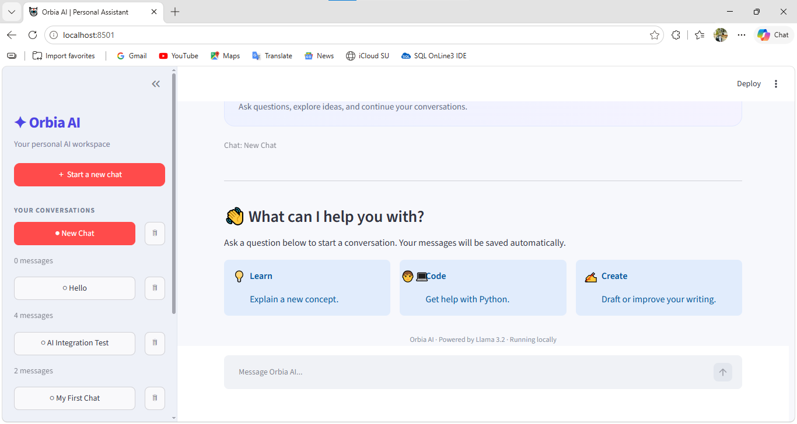

# 🤖 Orbia AI Chatbot

**A local AI assistant built with Python, Streamlit, Ollama, Llama 3.2, and SQLite.**

Orbia AI Chatbot is a conversational AI application that lets users interact with a locally running language model through a web interface. It supports persistent chat history, conversation management, and contextual follow-up questions.

<p align="center">
  
</p>

## ✨ Features

- 💬 **AI-powered conversations** — Ask questions and receive responses from Llama 3.2.
- 🖥️ **Interactive web interface** — Chat through a Streamlit application.
- 🏠 **Local AI inference** — Run the language model on your own computer with Ollama.
- 💾 **Persistent chat history** — Store conversations in an SQLite database.
- 🔄 **Conversation management** — Create new chats and reopen previous conversations.
- 🗑️ **Delete conversations** — Remove conversations with a confirmation step.
- 🕒 **Message timestamps** — View when messages were sent.
- 🧠 **Conversation context** — Use previous messages to support follow-up questions.
- 🎨 **Custom UI styling** — Clean layout with a sidebar, message cards, and chat history.

## 🛠️ Tech Stack

| Technology | Purpose |
|---|---|
| Python | Core application logic |
| Streamlit | Web interface |
| Ollama | Local model runtime |
| Llama 3.2 | Language model |
| SQLite | Persistent conversation storage |
| Git & GitHub | Version control |

## 📁 Project Structure

```text
Orbia-AI-Chatbot/
├── assets/
│   └── orbia-ai-chatbot.png
├── app.py
├── chatbot.py
├── database.py
├── requirements.txt
├── .gitignore
└── README.md
```

## 🚀 Getting Started

### Prerequisites

- Python 3.10 or newer
- Git
- Ollama installed on your computer
- Sufficient system memory to run the selected model

### 1. Clone the repository

```bash
git clone https://github.com/Farman002/Orbia-AI-Chatbot.git
cd Orbia-AI-Chatbot
```

### 2. Create a virtual environment

**Windows PowerShell:**

```powershell
python -m venv .venv
.\.venv\Scripts\Activate.ps1
```

### 3. Install dependencies

```bash
python -m pip install -r requirements.txt
```

If necessary, install the core packages manually:

```bash
python -m pip install streamlit ollama
```

### 4. Install and configure Ollama

Download Ollama from:

https://ollama.com/download

Download the Llama 3.2 model:

```bash
ollama pull llama3.2
```

Verify that the model is available:

```bash
ollama list
```

You can test it directly:

```bash
ollama run llama3.2
```

### 5. Run the application

From the project directory, execute:

```bash
python -m streamlit run app.py
```

Open the local URL displayed in the terminal, usually:

http://localhost:8501

## 💡 How to Use

1. Launch the application.
2. Click **Start a new chat**.
3. Enter a question in the chat input.
4. Receive a response generated by the local AI model.
5. Select an existing conversation from the sidebar to continue it.
6. Delete conversations using the trash icon and confirmation prompt.

Conversations are saved locally in SQLite and remain available after restarting the application, as long as the database file is preserved.

## 🗄️ Database Design

Orbia AI uses SQLite to persist conversation data.

**Conversations**

- `id` — Unique conversation identifier
- `title` — Conversation title
- `created_at` — Creation timestamp

**Messages**

- `id` — Unique message identifier
- `conversation_id` — Associated conversation
- `role` — User or assistant
- `content` — Message text
- `created_at` — Message timestamp

A conversation can contain multiple messages. Foreign-key enforcement and cascading deletion are used to remove associated messages when a conversation is deleted.

## 🔐 Privacy and Security

- The language model processes prompts locally through Ollama.
- Chat history is stored in a local SQLite database.
- The current Ollama integration does not require an OpenAI API key.
- Keep `.env`, `.venv`, and local database files out of version control.
- Do not expose the application to public networks without suitable authentication and security controls.

## 🔮 Future Enhancements

- Search conversations by title or content
- Group chat history by date
- Stream AI responses as they are generated
- Export conversations to TXT or PDF
- Add document question answering using retrieval-augmented generation (RAG)
- Add unit tests and improved error handling
- Support additional local language models

## 👨‍💻 Author

**Farman Naim**

GitHub: [Farman002](https://github.com/Farman002)

LinkedIn: [Farman Naim](https://www.linkedin.com/in/farman-naim)

## 📄 License

No license has been specified yet. Add a `LICENSE` file if you intend to grant others explicit permission to use, modify, or distribute this project.
